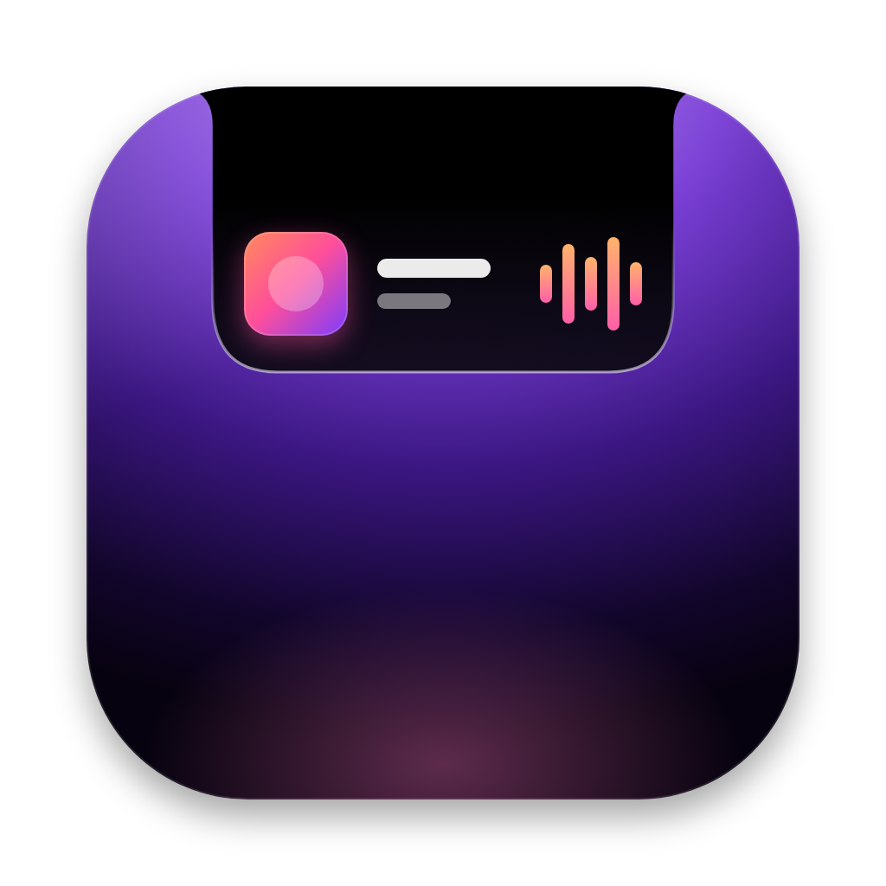

# MacNotch

MacNotch is a Dynamic Island for your MacBook. It sits over the notch the way the iPhone's island sits over the camera.



## What it does

- **Live Activities beside the notch.** When Apple Music is playing, the notch widens to show the album art on one side and moving sound bars on the other. Plugging in, unplugging and low battery (20% and 10%) each get a short iPhone-style alert.
- **Hover to open.** Move your pointer onto the notch and the island springs open into a Liquid Glass panel with your widgets. Move away and it tucks back in. If you'd rather click, you can change that in Settings.
- **Widgets you choose:**
  - **Now Playing:** artwork, song, a progress bar you can drag, and play, pause and skip buttons
  - **Weather:** current temperature, conditions and today's high and low for any city
  - **Web Pages:** icons for your saved sites, like Discord or YouTube. Click one to open it in your browser.
  - **File Shelf:** drag files onto the notch to park them, then drag them out wherever you need them
- **Make it yours.** Turn widgets on or off, reorder them, add or remove web pages, change the weather city, switch between Liquid Glass and Classic Black, and set how clear or tinted the glass looks.

## Install it on your MacBook

This takes about two minutes, and you won't need Terminal.

### 1. Download

1. Go to **github.com/handwerkerjonah08-prog/MacNotch** and sign in to GitHub.
2. On the right side of the page, click **Releases**, then click the newest **MacNotch** release.
3. Under **Assets**, click **MacNotch.dmg**. It saves to your Downloads folder.

### 2. Install

1. Open **MacNotch.dmg** from Downloads.
2. In the window that opens, drag the **MacNotch** icon onto the **Applications** folder.
3. Close the window, then eject the **MacNotch** disk in the Finder sidebar.

### 3. Open it the first time

MacNotch isn't sold on the App Store, so macOS asks you to approve it once.

1. Open your **Applications** folder and double-click **MacNotch**.
2. macOS says it can't verify the app. Click **Done**. (Don't click Move to Trash.)
3. Open **System Settings** and click **Privacy & Security** in the sidebar.
4. Scroll down to the **Security** section. Next to "MacNotch was blocked," click **Open Anyway**.
5. Enter your password or use Touch ID, then click **Open Anyway** again.

That's it. The island opens for a few seconds to say hi, and the MacNotch Settings window appears.

### 4. Finish setup

1. In Settings, under **General**, turn on **Open MacNotch at login** so it starts every time you turn on your Mac.
2. Play a song in **Apple Music**. macOS asks if MacNotch can control Music. Click **Allow**. This lets the island show artwork and use the play and skip buttons.
3. Under **Weather**, search for your city. It starts on Glencoe, IL.
4. Under **Web Pages**, add the sites you use. Click a suggestion, or click **Add Web Page** and paste any link.

## Using MacNotch

| To do this | Do this |
| --- | --- |
| Open the island | Move your pointer onto the notch |
| Close it | Move your pointer away |
| Open a web page | Click its icon in the island |
| Remove a web page | Right-click its icon and choose **Remove** |
| Park a file | Drag it onto the notch and let go |
| Use a parked file | Drag it out of the island, or double-click to open it |
| Open Settings | Click the gear in the island, right-click the island, or use the MacNotch icon in the menu bar |
| Quit | Right-click the island and choose **Quit MacNotch** |

## Updating

Download the newest **MacNotch.dmg** from Releases and drag it into Applications again. Choose **Replace** when asked. Your settings, web pages and shelf stay as they were. macOS may ask you to allow Music access again after an update, which is normal for apps from outside the App Store.

## Uninstalling

1. Right-click the island and choose **Quit MacNotch**.
2. Drag **MacNotch** from Applications to the Trash.
3. If you turned on Open at login, it disappears from **System Settings › General › Login Items** on its own. If it's still listed, remove it there.

## Troubleshooting

**I don't see the island.** It's invisible when nothing is happening, since it matches the notch exactly. Hover over the notch to open it. If nothing happens, check that the MacNotch icon is in the menu bar. If it isn't, open MacNotch from Applications.

**There's no Open Anyway button.** Double-click MacNotch in Applications once more, click Done, then go back to Privacy & Security. The button only appears for about an hour after you try to open the app.

**Now Playing says "Allow Music Access."** Open **System Settings › Privacy & Security › Automation**, find **MacNotch**, and turn on **Music**.

**Weather says unavailable.** Check your internet connection, then click **Retry** on the weather card.

**My Mac is closed and connected to a monitor.** The island moves to the top center of that display and draws its own notch there.

## For developers

MacNotch is a Swift package with no third-party dependencies.

```
Sources/NotchCore   Pure logic: models, settings, geometry, weather parsing, state machine
Sources/NotchUI     AppKit + SwiftUI: the notch panel, island views, widgets, services, settings
Sources/MacNotch    App entry point
Tests/              Unit tests for NotchCore and view model / rendering tests for NotchUI
scripts/            build-app.sh (app bundle + DMG) and smoke-test.sh (CI demo run)
```

- Build and run: `swift run MacNotch`
- Test: `swift test`
- Package: `scripts/build-app.sh 1.0.0 1` creates `build/MacNotch.app` and `build/MacNotch.dmg`
- Render every island state to PNG: `build/MacNotch.app/Contents/MacOS/MacNotch --render-snapshots build/snapshots`

Requires macOS 14 or later. Liquid Glass needs macOS 26 or later and the Xcode 26 SDK; older systems get a drawn version that looks close.

Every push runs the GitHub Actions workflow in `.github/workflows/build.yml`, which runs the tests, packages the DMG, renders snapshots and launches the app to check it doesn't crash. A commit message containing `[release]` publishes the DMG as a numbered release.

Weather data comes from [Open-Meteo](https://open-meteo.com) (CC BY 4.0).
