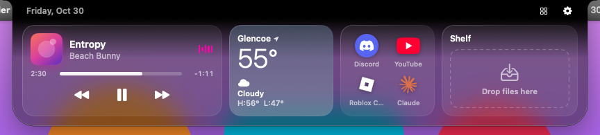
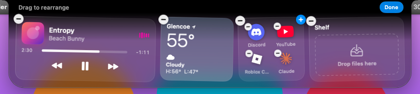
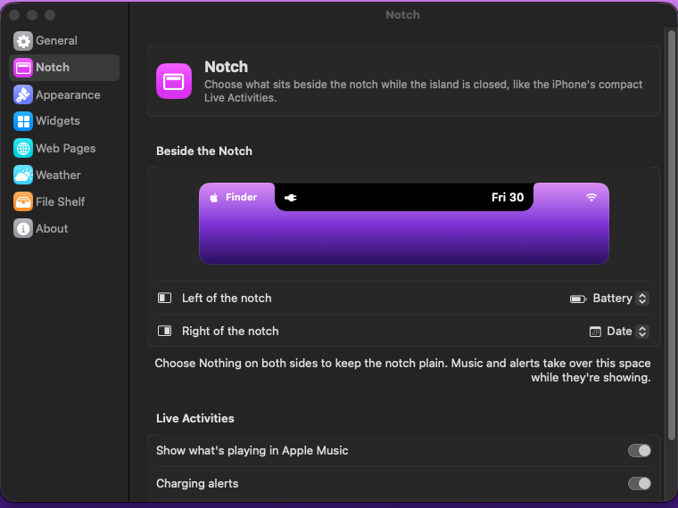

# MacNotch

MacNotch is a Dynamic Island for your MacBook. It sits over the notch the way the iPhone's island sits over the camera.



## What it does

- **Live Activities beside the notch.** When Apple Music is playing, the notch widens to show the album art on one side and moving sound bars on the other. Plugging in, unplugging and low battery (20% and 10%) each get a short iPhone-style alert.
- **You choose what sits beside the notch.** Pick weather, battery, time, date or your shelf count for each side, or nothing at all.
- **Hover to open.** Move your pointer onto the notch and the island springs open into a Liquid Glass panel with your widgets. Move away and it tucks back in. If you'd rather click, you can change that in Settings.
- **Widgets you choose:**
  - **Now Playing:** artwork, song, a progress bar you can drag, and play, pause and skip buttons
  - **Weather:** current temperature, conditions and today's high and low for any city
  - **Web Pages:** icons for your saved sites, like Discord or YouTube. Click one to open it in your browser. Icons show just the logo, with no tile behind them.
  - **File Shelf:** drag files onto the notch to park them, then drag them out wherever you need them
- **Edit it right in the island.** Click the grid button and everything wiggles like your iPhone's home screen. Drag widgets and web page icons to rearrange them, tap the minus to remove one, and use Add Widget to bring one back.
- **Save links by dropping them.** Drag a link from your browser's address bar onto the notch and it becomes a web page icon.
- **Apple's Liquid Glass.** On macOS 27 you get the new iOS 27 generation of Liquid Glass, straight from the system. There's a Clear-to-Tinted slider and a Classic Black option too.

| Beside the notch | Edit mode |
| --- | --- |
|  |  |



## Install it on your MacBook

About three minutes, no Terminal, and nothing on your Mac gets switched off.

### Before you start: what macOS will and won't ask

- **Gatekeeper stays on.** You approve MacNotch once with Apple's own **Open Anyway** button. That approval covers this one app. Gatekeeper keeps checking every other app exactly as before.
- **At most three small permissions, all optional:** controlling Apple Music (for Now Playing), opening at login, and seeing files you park on the shelf. Each is limited to that one thing and can be switched off any time in System Settings.
- **MacNotch never asks for** Accessibility, Screen Recording, Input Monitoring, Full Disk Access, Location, Camera or Microphone. If anything mentioning MacNotch ever asks for one of those, click Don't Allow; it isn't this app. You also never need to type commands that turn off Gatekeeper or System Integrity Protection.

**Why the one-time approval?** Apps from outside the App Store normally get a stamp from Apple called notarization, which needs a paid Apple developer account. MacNotch is signed but not notarized, so macOS asks you to confirm it once. Its full source code is public in this repository, and GitHub builds the app straight from that code.

### 1. Download

1. Go to **github.com/handwerkerjonah08-prog/MacNotch**. You don't need to sign in.
2. On the right side of the page, click **Releases**, then click the newest **MacNotch** release (the one marked **Latest**). Skip anything called "Preview build"; those are test builds.
3. Under **Assets**, click **MacNotch.dmg**. It saves to your Downloads folder.

### 2. Install

1. Open **MacNotch.dmg** from Downloads.
2. In the window that opens, drag the **MacNotch** icon onto the **Applications** folder.
3. Close the window, then eject the **MacNotch** disk in the Finder sidebar.

### 3. Approve it once

1. Open your **Applications** folder and double-click **MacNotch**.
2. macOS says "MacNotch" Not Opened because Apple couldn't check it. Click **Done**. (Not Move to Trash.)
3. Open **System Settings** and click **Privacy & Security** in the sidebar.
4. Scroll down to **Security**. Next to "MacNotch" was blocked to protect your Mac, click **Open Anyway**. The button shows up for about an hour after step 1.
5. Use Touch ID or your password, then click **Open Anyway** in the box that appears.

The island opens for a few seconds to say hi, and MacNotch Settings appears. From now on MacNotch opens normally.

### 4. Allow Apple Music (optional, for Now Playing)

1. Play any song in **Apple Music**.
2. macOS asks: "MacNotch" wants access to control "Music". Click **Allow**.

This only lets MacNotch read what's playing (song, artist, artwork) and press play, pause and skip for you. It can't touch any other app. If you'd rather not, click **Don't Allow**; everything else still works. You can change it later in **System Settings › Privacy & Security › Automation › MacNotch**.

### 5. Open at login (optional)

In MacNotch Settings, go to **General** and turn on **Open MacNotch at login**. macOS shows a "Login Item Added" notification; nothing else to approve. To undo it, turn the switch off, or use **System Settings › General › Login Items & Extensions**.

### 6. Files on the shelf (only if it comes up)

After you restart your Mac, if the shelf holds files from your **Desktop**, **Documents** or **Downloads** folder, macOS may ask: "MacNotch" would like to access files in your Desktop folder. Click **Allow** to keep seeing previews and opening those files from the shelf. This covers only that folder, and MacNotch only opens files you put on the shelf yourself. If you click **Don't Allow**, the files stay listed and you can still remove them. You can change it later in **System Settings › Privacy & Security › Files & Folders › MacNotch**.

### 7. Make it yours

- **Notch:** choose what sits beside the notch (weather, battery, time, date, shelf count or nothing).
- **Widgets:** turn widgets on or off. You can also do this right in the island with the grid button.
- **Web Pages:** add the sites you use, or drag a link from your browser onto the notch.
- **Weather:** search for your city. It starts on Glencoe, IL.

### Permissions at a glance

| What | When macOS asks | Why | Where to change it |
| --- | --- | --- | --- |
| Open Anyway | Once, the first time you open it (and after each update) | Approve this one app | Privacy & Security |
| Automation › Music | The first time something plays | Artwork and music controls | Privacy & Security › Automation |
| Login Items | Only if you turn on Open at login | Start when you log in | General › Login Items & Extensions |
| Files & Folders | Only for shelf files in Desktop, Documents or Downloads | Show and open those files | Privacy & Security › Files & Folders |
| Accessibility, Screen Recording, Input Monitoring, Full Disk Access, Location, Camera, Microphone | Never | Not used | |

MacNotch notices your pointer near the notch through a standard macOS feature that needs no permission. It can't see what you type or what's on your screen.

### What MacNotch connects to

- **Open-Meteo**, for weather. It sends the location of the city you picked.
- **Apple's iTunes Search**, only when a song has no artwork. It sends the artist and album name.
- **Google's and DuckDuckGo's icon services**, plus the site itself, to fetch icons for your saved web pages. They see which site's icon was requested.

That's all. No account, no analytics, no tracking.

## Using MacNotch

| To do this | Do this |
| --- | --- |
| Open the island | Move your pointer onto the notch |
| Close it | Move your pointer away |
| Open a web page | Click its icon in the island |
| Save a web page | Drag a link from your browser onto the notch, or use **Settings › Web Pages** |
| Rearrange or remove widgets and icons | Click the grid button in the island (or right-click it and choose **Edit Widgets**), drag things around, tap a minus to remove, then **Done** |
| Bring a widget back | In edit mode, click **Add Widget** |
| Choose what sits beside the notch | **Settings › Notch** |
| Park a file | Drag it onto the notch and let go |
| Use a parked file | Drag it out of the island, or double-click to open it |
| Open Settings | Click the gear in the island, right-click the island, or use the MacNotch icon in the menu bar |
| Quit | Right-click the island and choose **Quit MacNotch** |

## Updating

Download the newest **MacNotch.dmg** from Releases and drag it into Applications again. Choose **Replace** when asked. Your settings, web pages and shelf stay as they were. Because each version is a new, unnotarized build, macOS asks you to approve it with **Open Anyway** again (step 3) and may ask about Music again (step 4).

## Uninstalling

1. Right-click the island and choose **Quit MacNotch**.
2. Drag **MacNotch** from Applications to the Trash.
3. If you turned on Open at login, it disappears from **System Settings › General › Login Items & Extensions** on its own. If it's still listed, remove it there.
4. Optional: in **System Settings › Privacy & Security**, remove MacNotch from **Automation** and **Files & Folders** if it's listed.

## Troubleshooting

**I don't see the island.** It's invisible when nothing is happening, since it matches the notch exactly. Hover over the notch to open it. If nothing happens, check that the MacNotch icon is in the menu bar. If it isn't, open MacNotch from Applications.

**There's no Open Anyway button.** Double-click MacNotch in Applications once more, click Done, then go back to Privacy & Security. The button only appears for about an hour after you try to open the app.

**macOS says MacNotch is damaged.** The download didn't finish. Delete it, download MacNotch.dmg again and repeat the steps.

**Now Playing says "Allow Music Access."** Open **System Settings › Privacy & Security › Automation**, find **MacNotch**, and turn on **Music**.

**Weather says unavailable.** Check your internet connection, then click **Retry** on the weather card.

**My Mac is closed and connected to a monitor.** The island moves to the top center of that display and draws its own notch there.

## For developers

MacNotch is a Swift package with no third-party dependencies.

```
Sources/NotchCore   Pure logic: models, settings, geometry, weather parsing, state machine
Sources/NotchUI     AppKit + SwiftUI: the notch panel, island views, widgets, services, settings
Sources/MacNotch    App entry point
Tests/              Unit tests for NotchCore and view model / rendering tests for NotchUI
scripts/            build-app.sh (app bundle + DMG) and smoke-test.sh (CI demo run)
```

- Build and run: `swift run MacNotch`
- Test: `swift test`
- Package: `scripts/build-app.sh 1.0.0 1` creates `build/MacNotch.app` and `build/MacNotch.dmg`
- Render every island state to PNG: `build/MacNotch.app/Contents/MacOS/MacNotch --render-snapshots build/snapshots`

Requires macOS 14 or later. Liquid Glass needs macOS 26 or later; releases are built with Xcode 27 so macOS 27 shows the newest glass. Older systems get a frosted blur that looks close.

Every push runs the GitHub Actions workflow in `.github/workflows/build.yml` on macOS 27 with Xcode 27. It runs the tests, packages the DMG and renders snapshots. It also launches the real app, walks it through every state, and drives the real mouse pointer to hover the notch, enter edit mode, drag a widget, remove one and open Settings. A commit message containing `[release]` publishes the DMG as a numbered release.

Weather data comes from [Open-Meteo](https://open-meteo.com) (CC BY 4.0).
